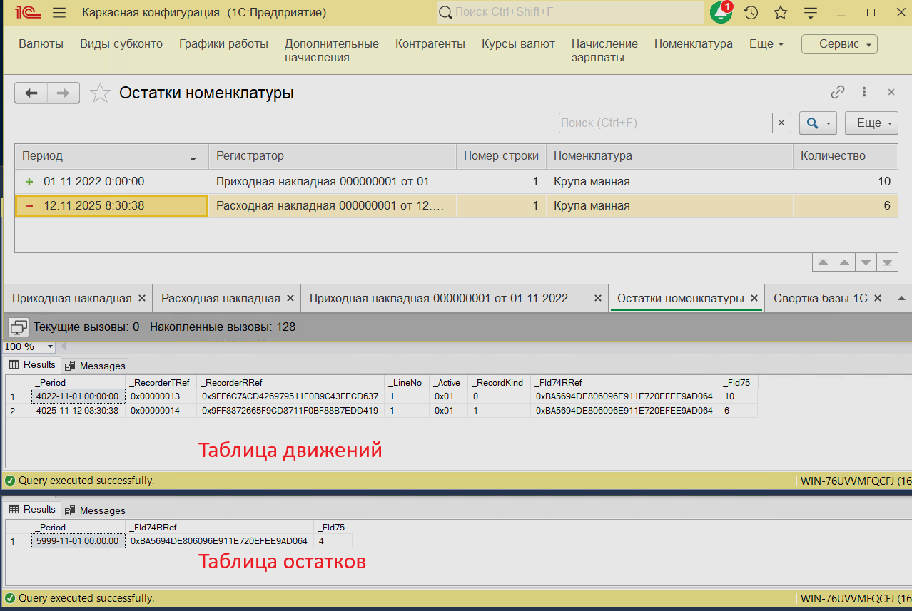

# Регистр накопления. Остатки

<iframe width="560" height="315" src="https://www.youtube.com/embed/NiNr8g-xcuA" title="YouTube video player" frameborder="0" allow="accelerometer; autoplay; clipboard-write; encrypted-media; gyroscope; picture-in-picture; web-share; fullscreen" referrerpolicy="strict-origin-when-cross-origin" allowfullscreen></iframe>

* ключ записи в регистре накоплений - регистратор и номер строки;

* для записи и чтения доступна только таблица движений;
* актуальные остатки рассчитаны на дату 01.11.3999;
* необходимо обеспечить выход регистра в 0:
    * приход, расход;
    * измерения;
    * проблема копеек.

